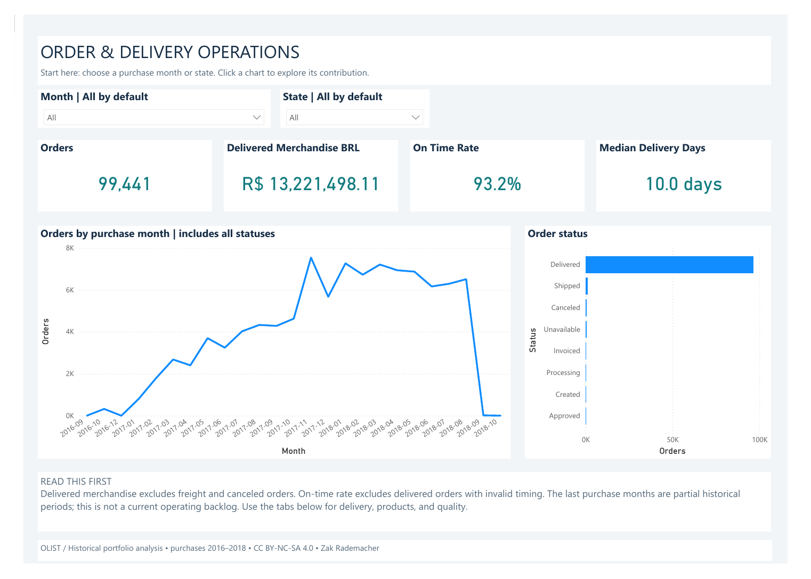

# Commerce Operations | Power BI

A native Power BI report that turns six linked Kaggle CSVs into an order and
delivery review. The Python pipeline validates keys, reconciles exact currency,
retains exceptions and publishes a consistent snapshot for repeatable refresh.

**Business questions:** Which states account for the most late deliveries? How
does that compare with late rate? Which product categories contribute merchandise
value and freight? Which data-quality issues affect the metrics?



**Open the project:** [Interactive PBIX](deliverables/Commerce%20Operations%20Dashboard.pbix)
 · [Four-page PDF preview](deliverables/Commerce%20Operations%20Dashboard.pdf)
 · [Business case study](docs/case-study.md)

Download the repository ZIP to retain the code, demo data and documentation.
The PBIX opens with imported data; a refresh on another computer requires the
one-time DataRoot setup in the user guide.

## What the full snapshot says

| Measure | Result |
|---|---:|
| Source orders, all statuses | 99,441 |
| Source item lines | 112,650 |
| Delivered merchandise, excluding freight | BRL 13,221,498.11 |
| Valid delivery timing population | 96,470 |
| Late deliveries | 6,534 |
| On-time delivery rate | 93.2% |
| Median purchase-to-delivery time | 10 calendar days |
| Delivered orders excluded from timing | 8 |

São Paulo has the largest late-order volume (1,820). That is a workload signal,
not evidence it has the worst rate: its eligible population is also the largest.
Health Beauty leads delivered category merchandise at BRL 1,233,131.72. These are
historical observations, not claims about current Olist operations or client savings.

## Report pages

- **Overview:** headline measures, purchase-month trend and source status mix.
- **Delivery:** late volume by state, rate trend and sortable state comparison.
- **Products:** category filtering, delivered merchandise and freight burden.
- **Quality & Refresh:** source counts, overlapping checks, snapshot identity and definitions.

Use the PBIX for the imported offline demonstration. The PBIP contains editable
native report definitions and semantic model source. All visuals are built-in
Power BI visuals; no paid custom visual is needed.

## Reproduce and refresh

Python 3.11+; standard library only. From the repository root:

To unpack and check the included demo snapshot:

```powershell
python src/prepare_demo.py
python src/verify_snapshot.py
```

The checksum-verified `sample-data.zip` bundles the clean CSVs and SQLite handoff.
These two commands are sufficient for the demo; the PBIX already contains its
imported data. To rebuild from the original Kaggle CSVs instead:

```powershell
python src/download_data.py
python -m unittest discover -s tests -v
python src/pipeline.py
python src/verify_snapshot.py
```

Open `powerbi/Commerce.pbip` or the packaged PBIX. Set **DataRoot** in Power Query's
Edit parameters to the absolute path of `data/processed` on your machine. Choose
Home > Refresh, then compare the imported snapshot with `latest.json`.

Automation is on demand: replacing the six source snapshots and rerunning Python
rebuilds clean tables; Desktop Refresh recalculates the dashboard. It does not
download new Kaggle data, run Python, or set up a cloud schedule by itself.

## Why the numbers are defensible

- Orders and item lines have separate facts; payments aggregate before joining.
- Every source order and item is retained. Duplicate keys and orphan links fail validation.
- Money is stored in exact integer cents; report measures divide by 100.
- Missing or reversed delivery timing is flagged and excluded from timing metrics.
- Actual and promised calendar dates determine lateness; same-day delivery is on time.
- Source payment differences are exposed rather than forced into agreement.
- A failed rebuild preserves the previous published snapshot pointer.
- Independent CSV and SQLite checks produce `docs/reconciliation.json` with expected slicer results.

## Documentation and handoff

| Document | Purpose |
|---|---|
| [User guide](docs/user-guide.md) | Open, filter, move, refresh and troubleshoot |
| [Cleaning rules](docs/cleaning-rules.md) | Transformation decisions and metric definitions |
| [Data dictionary/model](docs/data-dictionary.md) | Table grains, fields and relationships |
| [Source and license](docs/source-and-license.md) | Kaggle attribution, hashes and data rights |
| [Skills walkthrough](docs/skills-walkthrough.md) | Explain and maintain this portfolio example |
| [Case study](docs/case-study.md) | Business findings and a two-minute demonstration |
| [Validation record](docs/qa.md) | Automated checks, native interaction checks and limits |
| [SQL review queries](sql/operations_review.sql) | Reproduce operational summaries in SQLite |
| [DAX measures](powerbi/measures.dax) | Explicit metric formulas and descriptions |
| [Power Query](powerbi/power-query.m) | Refresh source and explicit data types |

## Scope and licensing

Independent portfolio demonstration using [Olist's Brazilian E-Commerce Public
Dataset](https://www.kaggle.com/datasets/olistbr/brazilian-ecommerce), historical
2016–2018 records. Not commissioned work for Olist or Albertsons. No costs,
profit, inventory, verified savings or causal delivery explanation is available.
Final purchase months are partial. Category filters reach item metrics only.
The order-status chart counts each order's recorded status at dataset capture.
Delivered and Shipped are separate current-status groups, not cumulative counts
of orders that have ever reached those milestones.

Original reusable code is MIT licensed. Source data, derived tables and embedded
report data retain **CC BY-NC-SA 4.0**, including noncommercial and share-alike
conditions. Do not assume the sample data can be reused in paid client work.
