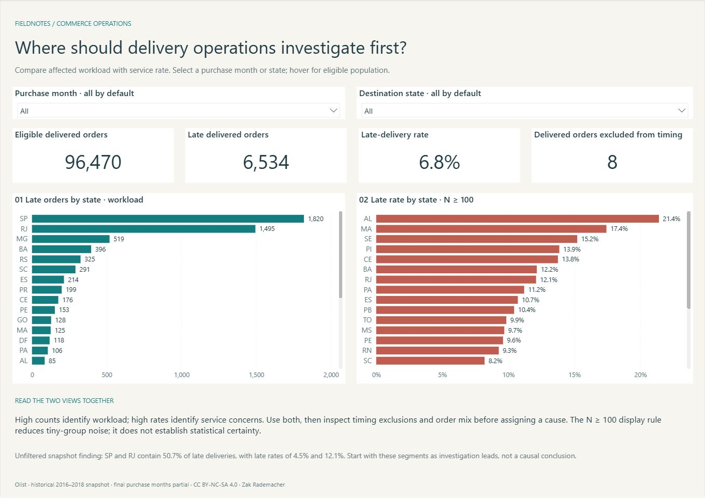

# Commerce Operations | Power BI

   

**Where should an operations team investigate late deliveries, and how does workload differ from service rate?**

A focused two-page **Power BI** delivery-prioritization report built from six related historical source files, with **Python/SQLite** validation and separate order/item facts. The original broader report is retained.

**Current report:** [Delivery Priorities / Power BI](deliverables/Commerce%20Delivery%20Priorities.pbix) · [Open / refresh guide](powerbi-rebuild/README.md)



[Earlier four-page PDF](deliverables/Commerce%20Operations%20Dashboard.pdf) · [Earlier four-page PBIX](deliverables/Commerce%20Operations%20Dashboard.pbix) · [Read the case study](docs/case-study.md)

## Findings

- **6,534 of 96,470 eligible deliveries were late**; the on-time rate was **93.2%**.
- São Paulo and Rio de Janeiro account for **50.7% of late deliveries**, but their late rates differ: **4.5% versus 12.1%**. Compare workload with rate before prioritizing an investigation.
- **1,348 orders** have payment-versus-merchandise-and-freight differences. These remain visible for reconciliation rather than being forced into agreement.

A useful next step is to investigate delivery segments in those states using both affected volume and rate. The snapshot cannot establish causes or current operating conditions.

## Inspect the model

The snapshot contains **99,441 orders and 112,650 item lines**. Dates and States filter both facts; Categories filter item measures only. Payments aggregate to order grain before joining, preventing multiplied totals. Amounts remain integer cents through preparation.

[Model and table grains](docs/data-dictionary.md) · [DAX measures](powerbi/measures.dax) · [SQL review queries](sql/operations_review.sql) · [Editable Power BI project](powerbi/Commerce.pbip)

## Open and refresh


Download and extract the repository ZIP, then open the PBIX; its sample is already imported. To unpack and validate the included refresh inputs, run from the repository root with Python 3.11+:

```powershell
python src/prepare_demo.py
python src/verify_snapshot.py
```

Set Power Query's **DataRoot** parameter to your local `data/processed` folder, then select **Home > Refresh**. [User guide and troubleshooting](docs/user-guide.md).

## Technical detail

- [Reproduction, validation and licensing detail](docs/PROJECT_GUIDE.md)
- [Cleaning rules and metric definitions](docs/cleaning-rules.md)
- [Validation record](docs/qa.md) · [Reconciliation evidence](docs/reconciliation.json)
- [Python pipeline](src/pipeline.py) · [Tests](tests)
- [Source and license](docs/source-and-license.md)

## Scope

Independent demonstration using Olist's historical 2016–2018 data. Final purchase months are partial; the trend is not evidence of a current business decline. Statuses describe the recorded snapshot, not milestone history. Merchandise excludes freight and is not profit or recognized revenue.

Refresh runs on demand; cloud scheduling is not configured. Original code is [MIT](LICENSE); source data and derived report data retain **CC BY-NC-SA 4.0**, including noncommercial and share-alike conditions. See the source guide before reusing data.

