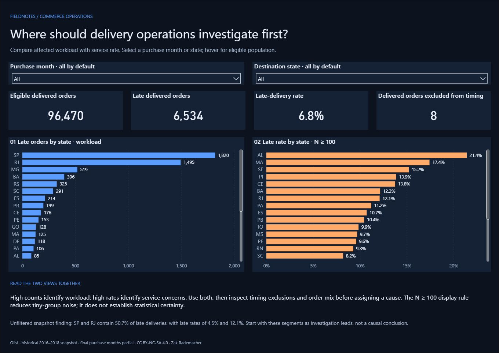

# Commerce Operations

A state with the most late deliveries isn't necessarily the state with the highest late rate. I built this review to compare both and give an operations team a clearer starting point for investigation.

The project combines six Olist source files into checked reporting tables and a **two-page Power BI delivery report**. Python and SQLite handle preparation and reconciliation across **99,441 orders and 112,650 item lines**.

[View the report](deliverables/delivery-priorities-preview.png) · [Download the PBIX](deliverables/Commerce%20Delivery%20Priorities.pbix) · [Read the SQL investigation](docs/SQL_INVESTIGATION.md)



## What I found

Across the historical snapshot, **6,534 of 96,470 eligible deliveries were late**, giving an on-time rate of **93.2%**. São Paulo and Rio de Janeiro accounted for **50.7%** of late deliveries, but their late rates differed: **4.5% and 12.1%**.

The monthly SQL comparison shows why the selected period matters. In July 2018, SP had **100 late deliveries among 2,712 eligible orders**. AL had **four among 22**: a higher rate, based on a much smaller population. AL stays visible but isn't included in the rate ranking, which requires at least 100 eligible deliveries. That cutoff is a display rule, not a significance test.

I'd start by reviewing the late SP orders in that month and asking for carrier, route, and service-promise information. The source identifies a workload; it doesn't establish its cause or describe current service performance.

[Query](sql/delivery_priorities.sql) · [All state/month results](deliverables/delivery-investigation) · [Definitions](docs/cleaning-rules.md)

## How the model avoids double counting

Orders and item lines stay in separate fact tables. Payments are summed to one row per order before joining, so split payments and multiple items don't multiply totals. Dates and states filter both facts; categories filter item measures only. Monetary values stay in integer cents through preparation.

The source also has **1,348 payment-versus-merchandise/freight differences**. I kept these visible instead of forcing the figures to agree. Merchandise excludes freight and isn't a measure of profit or recognized revenue.

[Model and table definitions](docs/data-dictionary.md) · [Current report source](powerbi-rebuild/DeliveryPriorities.pbip) · [SQL review queries](sql/operations_review.sql)

## Open and refresh

Download and extract the repository, then open the PBIX in Power BI Desktop. Its sample data is already imported. For a local refresh, run these commands from the repository root with Python 3.11+:

```powershell
python src/prepare_demo.py
python src/verify_snapshot.py
python tools/investigate_delivery.py
```

Set Power Query's **DataRoot** parameter to your absolute `data/processed` folder, then select **Home > Refresh**. Filters update the report metrics; text labeled **unfiltered snapshot** stays fixed. [Current report guide](powerbi-rebuild/README.md).

The SQL companion reads the existing SQLite snapshot. It doesn't require dbt or a hosted warehouse. Source rebuilding and Desktop refresh are separate, on-demand steps.

## Methods and verification

- [Operating guide](docs/PROJECT_GUIDE.md) · [Validation](docs/qa.md) · [Reconciliation](docs/reconciliation.json)
- [Source and license](docs/source-and-license.md) · [Pipeline](src/pipeline.py) · [Tests](tests)
- [Case study](docs/case-study.md) · [Visual maintenance](docs/VISUAL_DESIGN.md)

This independent project uses Olist's historical 2016–2018 data. Final purchase months are partial, and order statuses describe the recorded snapshot rather than a full history of status changes.

The earlier four-page [Power BI report](https://github.com/ZakJRademacher/commerce-operations-powerbi/blob/11d10fcb46b2e7d094acaac4c4802f5cc9450c5e/deliverables/Commerce%20Operations%20Dashboard.pbix) and [editable source](https://github.com/ZakJRademacher/commerce-operations-powerbi/tree/11d10fcb46b2e7d094acaac4c4802f5cc9450c5e/powerbi) remain in repository history. The two-page report above is the current download.

Original code: [MIT](LICENSE). Source data and derived report data retain **CC BY-NC-SA 4.0**, including its noncommercial and share-alike conditions.
