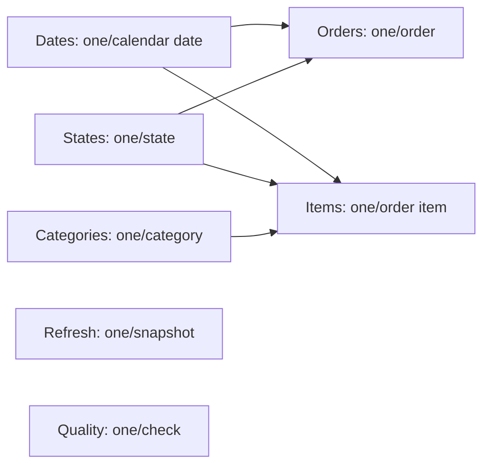

# Data dictionary and model

All relationships filter from dimensions to facts in one direction. Orders and
Items are deliberately not joined inside the semantic model. Dates use purchase
date consistently. Category filters reach Items only; only item measures appear
on Products. Other report pages use order metrics and no category slicer. Quality
and Refresh are disconnected, full-snapshot diagnostic tables.

| Table / column | Type | Meaning |
|---|---|---|
| Orders / Order ID | Text | Pseudonymous unique source order key |
| Orders / Purchase Date | Date | Source order purchase calendar date |
| Orders / State | Text | Customer state, validated Brazilian abbreviation |
| Orders / Status | Text | Source status with display capitalization |
| Orders / Delivered Date, Estimated Date | Nullable date | Source actual and promised calendar dates |
| Orders / Item Count | Integer | Number of source item rows aggregated by order |
| Orders / Merchandise Cents, Freight Cents | Integer | Exact item prices / freight aggregated by order |
| Orders / Payment Cents | Nullable integer | Sum of payment rows; blank if absent |
| Orders / Payment Difference Cents | Nullable integer | Payment minus merchandise minus freight |
| Orders / Delivery Eligible, Late | Integer 0/1 | Defined in cleaning rules; Late=0 for ineligible orders |
| Orders / Delivery Days, Late Days | Nullable integer | Calendar days; blank for ineligible orders |
| Orders / Delivery Band | Text | 0–7, 8–14, 15–30, 31+ days or Not eligible |
| Items / Order ID + Item Number | Text + integer | Composite source key; one unit per source item row |
| Items / Product ID | Text | Pseudonymous source product key |
| Items / Purchase Date, State, Status | Date / text | Validated order/customer attributes copied once |
| Items / Category | Text | Supplied English category, Portuguese fallback, or Uncategorized |
| Items / Category Mapping | Text | English translation / Portuguese fallback / missing source category |
| Items / Category Group | Text | Full-snapshot top ten categories, otherwise Other categories |
| Items / Price Cents, Freight Cents | Integer | Exact source monetary amounts per item |
| Dates / Date, Month, Year | Date / text / integer | Continuous calendar, YYYY-MM and numeric year |
| States / State | Text | 27 valid Brazilian state / federal district codes |
| Categories / Category | Text | Unique display categories observed in Items |
| Quality / Check, Rows | Text / integer | Named diagnostic and its count, possibly overlapping |
| Refresh | Mixed | Snapshot fingerprint, UTC build time, row and exception counts |
| Exceptions.csv | Text | Order ID, rule and human-readable detail; not imported into Power BI |

Raw numeric fact columns are hidden in Power BI so readers use documented explicit
measures. Measure formulas and descriptions are in `powerbi/measures.dax` and the
semantic model. CSVs use UTF-8, ISO dates, headers and blank nullable values.
